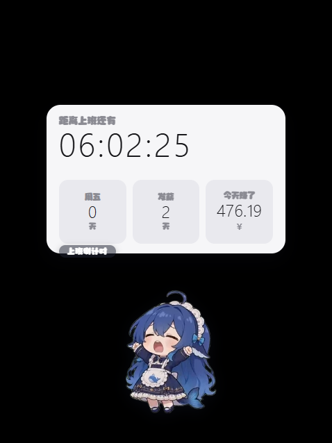

# 好搭子 · 鲸鱼娘桌宠

一只住在你桌面上的 DSH 鲸鱼娘。鼠标落在她身上就报工时：**距离下班还有多久、离周五几天、离发薪几天、今天赚了多少**。
每到整点自动播报一遍（气泡 + 少女音）。



> 形象素材来自 DSH 的 [`dsh-pet`](https://github.com/) 插件（webm 透明动画 + 上首软糖体），本项目是独立桌面应用，**不依赖 DSH 运行**。

---

## 功能

| 功能 | 说明 |
| --- | --- |
| 桌宠本体 | 透明 webm 动画，按时段自动切换：上班=忙碌点按 / 上班前=思考冒泡 / 下班后=打瞌睡 / 深夜=待机呼吸 / 发薪当天=雀跃庆祝 |
| 悬停信息卡 | 鼠标**真正落到她身上**才浮出卡片：倒计时大数字 + 周五 / 发薪 / 今天赚了 三格。卡片跟着她走 |
| 日薪折算 | 填一个月薪，自动按「本月实际工作日数」或「固定 21.75 天」折成日薪，休息日显示 0.00 |
| 整点播报 | 每到整点弹气泡 + 语音朗读，点一下气泡就消失 |
| 设置面板 | 上下班时间、月薪、发薪日、工作日、播报开关与音量、音色、桌宠大小、开机自启 |
| 拖动 / 甩抛 | 按住拖动是弹簧跟手；用力甩出去沿抛物线飞，**撞到真正的桌面边缘**才反弹 |
| 托盘常驻 | 右下角托盘图标：显示/隐藏、设置、立即播报、开机自启、退出 |

## 互动（移植自 dsh-pet）

dsh-pet 里能脱离 DSH 单独用的那些互动都搬过来了（**余额展示和对话除外**——那两块依赖 DSH 会话，独立跑没意义）：

| 互动 | 说明 |
| --- | --- |
| 拖拽跟手 | 按住拖动是弹簧跟手，不抖不飘；松手按最后轨迹估速 |
| 甩抛飞行 | 沿抛物线飞，撞桌面边缘按恢复系数反弹，落地摩擦减速到停 |
| 落地 Q 弹 | 每次落地按冲击速度挤压回弹（轻落 0.8 ~ 重砸 0.55） |
| 点击回应 | 点一下随机回应动画 + 一句台词（傲娇生气 / 元气挥手 / 害羞惊讶 / 开心跃动 / 挠痒咯咯笑） |
| 点击积分 | 飞行中把她按下去，爆出粒子 + 积分卡片，分数 = 速度/100 × 462/大小（越快越小分越高） |
| 碎碎念 | 每隔一段时间自己冒一句（本地台词库，不调模型），还会随机配一张表情包 |
| 表情包 | 右键「随机表情包」，27 张内置梗图 |
| 随机动作链 | 永不停止的动画链：待机 10 / 转向 5 / 移动 5，其余归随机动作分类，50+ 段动画 |
| 漫游走动 | 空闲时自己在**整个桌面**上走一段，窗口跟着她跑，朝向跟着方向镜像 |
| 右键菜单 | 碎碎念 / 随机表情包 / 回到初始位置 / 动作点播（分类 → 具体动画）/ 设置 |

## 语音

播报用**三套引擎**，设置里可切：

| 引擎 | 说明 |
| --- | --- |
| **元气少女（Edge 在线音色）** | 微软 Edge 的神经网络音色，默认 `zh-CN-XiaoyiNeural`（官方标注 Lively，活泼少女）。可调语速与音调，调高更元气。**App 内置 Node 版实现，装完即用，不用装 Python、不用装任何东西**（需要联网；直连不通就自动回落离线音色，失败会自动重试一次） |
| **本地离线女声（随包附带）** | 安装包里带了 Piper 神经网络 TTS 引擎 + 中文女声音模（zh_CN-huayan），**断网也能播**，约 0.6 秒出声。合成后会自动把音调提上去一点，避免太成熟太闷 |
| **系统女声（离线）** | Windows 自带的中文语音（Yaoyao / Huihui / Kangkang），用音调 + 语速调出活泼感，完全兜底 |

默认「自动」：先用在线的元气少女音，断网自动切随包的离线女声，再不行才用系统女声——**任何一台电脑都不会哑**。

播报文案也有两版：「元气口吻」（"叮咚～现在是…继续冲呀！"）和朴素版，设置里可切。

## 用法

- **鼠标落在她身上** → 浮出信息卡（必须真正碰到她，靠近不算）
- **双击**鲸鱼娘 → 打开设置
- **拖动**鲸鱼娘 → 挪位置（她能在整个桌面上走，窗口跟着她跑）
- **甩出去** → 沿抛物线飞，撞到真正的桌面边缘才反弹
- **单击**鲸鱼娘 → 放「蓝鲸现世」小技能
- **右键**鲸鱼娘 → 打开菜单
- 快捷键：`Ctrl+Alt+W` 立即播报一次，`Ctrl+Alt+S` 打开设置
- 托盘图标右键 → 各项开关

## 设置项说明

- **上班/下班时间**：支持跨夜班（下班早于上班会自动当成跨夜，比如 22:00—06:00）
- **工作日**：决定「今天赚了」是否计薪、离下一个工作日还有多久
- **月薪**：填一个月的总数
- **发薪日**：1—31 号，或「月底」= 当月最后一天
- **日薪算法**：
  - `按本月实际工作日` —— 月薪 ÷ 本月实际工作日天数（随月份浮动，真实）
  - `按固定 21.75 天` —— 月薪 ÷ 21.75（社保标准，不随月份变）

## 开发与打包

```bash
npm install

# 可选：下载离线音色模型（约 60MB，不下也能用在线音色）
#   PowerShell: powershell -ExecutionPolicy Bypass -File scripts/fetch-voice-model.ps1
#   Bash:        bash scripts/fetch-voice-model.sh

npm start          # 本地跑
npm run dist       # 产出 dist/ 下的安装包与便携版
```

Windows 上打包注意：Electron 43 的 **exe 文件名不能用中文**（会崩在 `EXCEPTION_BREAKPOINT`），所以安装包里的可执行文件叫 `HaoDaZi.exe`，而窗口标题、开始菜单快捷方式都是中文「好搭子」。

## 技术

Electron 43 + 原生 JS（无框架）。

- 透明无边框置顶窗 + `setIgnoreMouseEvents` 做点击穿透，**悬停判定放在主进程轮询系统光标**（比转发 mousemove 稳）
- 窗口跟随宠物：宠物的位置用**屏幕坐标**算，窗口做固定落点跟着跑 —— 这样她才能飞到真正的桌面边缘
- 语音三套引擎：内置 Node 版 Edge TTS（复刻了 `Sec-MS-GEC` v2 令牌算法）/ Piper 离线 TTS / Windows 系统语音

## 目录

```
src/
  main.js          主进程：窗口、托盘、配置、整点定时器、语音
  preload.js       渲染层与主进程之间的桥
  pet.html/css/js  桌宠窗口
  settings.html/css/js 设置窗口
  lib/calc.js      时间/工资计算（主进程与渲染层共用一份，避免算出两套）
  lib/physics.js   拖拽/飞行/落地 Q 弹物理
  lib/edge-tts.js  纯 Node 的 Edge 神经网络 TTS 客户端
  lib/tts.js       三套语音引擎的统一入口
  lib/gec.js       Sec-MS-GEC v2 令牌算法（BigInt 精确实现）
assets/
  webm/            鲸鱼娘动画（来自 dsh-pet）
  memes/           表情包（来自 dsh-pet）
  fonts/           上首软糖体
tts/
  piper/           Piper TTS 引擎（离线中文女声）
  voices/          语音模型（用 scripts/fetch-voice-model.* 下载）
```

## 致谢与许可

- 鲸鱼娘动画、表情包、上首软糖体来自 DSH 的 `dsh-pet` 插件（MIT）
- 离线语音：[Piper](https://github.com/rhasspy/piper)（MIT）+ [piper-voices](https://huggingface.co/rhasspy/piper-voices) 的 `zh_CN-huayan-medium`（MIT）
- 在线语音：微软 Edge 的公开 TTS 接口

本项目 MIT。
